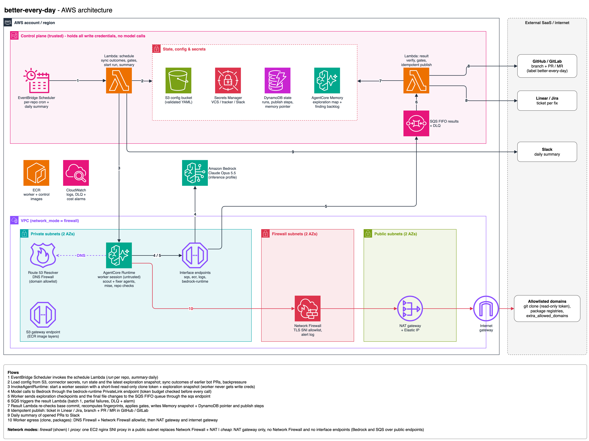

# better-every-day

A self-hosted service that makes selected repositories a little better every day. It scans a repo and saves its understanding and findings in persistent AgentCore Memory, so scheduled runs can work through small, real problems without repeating exploration. Once the backlog is exhausted, it explores again. Each fix runs in a sandbox, passes the repo's own checks, gets a ticket (when a tracker is configured) and becomes a pull request. Humans only review. A daily Slack message lists what was opened.

## Architecture



- **Control plane** (AWS Lambda, trusted): loads config, syncs outcomes of earlier bot PRs, applies backpressure, starts worker sessions, gates results, creates tickets, pushes branches, opens PRs, sends the summary. Holds all write credentials. Makes no model calls and runs no repo code.
- **Worker** (Bedrock AgentCore Runtime session, untrusted): clones with a short-lived read-only token, installs toolchains with `mise`, runs a scout agent and a fixer agent (Strands, Opus on Bedrock), verifies with the repo's commands and returns file changes over SQS. It never sees VCS write or tracker credentials.
- **Exploration memory** (AgentCore Memory): stores a compact repository map, candidate backlog and attempted findings across worker sessions. Workers send incremental checkpoints over SQS; the control plane validates them, writes snapshots to Memory and keeps the latest snapshot pointer in DynamoDB. Later runs recheck and fix cached findings without scouting again; exploration resumes when the backlog is exhausted. Memory is treated as untrusted repository data, and automatic memory extraction is disabled to avoid extra model calls.
- **Dependency cache** (S3): after a green baseline and before any agent runs, the worker uploads its `mise` toolchains and package-manager caches as one archive per repository; later sessions restore it before installing. The control plane hands each session one-hour credentials limited to that repository's object, so one repository cannot read or poison another's cache.
- **Untrusted worker output**: the control plane checks that the worker's base commit is on the base branch and recomputes every fingerprint itself.
- **Gates in code**: diff size, file count, excluded and protected paths, path safety, overlap with open bot PRs, duplicate fingerprints, green verification. Rejections are recorded, never published.
- **Idempotent publish**: ticket, branch and PR are looked up before being created, and every step is saved, so a redelivered or retried result never creates a second ticket or PR.
- **Learning**: merged and closed bot PRs feed a short per-repo lessons text into later runs; only comments by repo owners, members and collaborators are used, and lessons go into the user message marked as data, never into the system prompt. Closed fingerprints are never proposed again.
- **Budgets**: token budget and wall-clock timeout are checked before every model call, not only between fixes.
- **Ports and adapters**: `bed.core`, `bed.agents`, `bed.worker` and `bed.connectors` import nothing from AWS. AWS lives in `bed.platform.aws` and `infra/terraform/aws`.

```
src/bed/core          models, config, gates, ports, control-plane logic
src/bed/agents        prompts, workspace tools, Strands runner
src/bed/worker        shell, workspace, pipeline, AgentCore entrypoint
src/bed/connectors    github, gitlab, linear, jira, slack, shared HTTP client
src/bed/platform/aws  DynamoDB, Secrets Manager, SQS, S3 dependency cache, AgentCore Runtime and Memory, Lambda handlers
docker/               worker and control images (linux/arm64)
infra/terraform/aws   VPC, firewall or egress proxy, runtime, memory, cache bucket, Lambdas, table, queue, schedules
config/               example configurations (GitHub + Linear, GitLab + Jira, no tracker)
examples/ci/          copy-ready GitHub Actions and GitLab CI deploy pipelines
```

## Configuration

One YAML file, validated with `uv run bed validate <path>` and again at `terraform plan`. Unknown keys are errors. See `config/example.yaml` (GitHub, Linear, Slack), `config/example-gitlab-jira.yaml` (GitLab, Jira, Slack) and `config/example-no-tracker.yaml` (GitHub only, no tickets).

| Key                                                                                             | Meaning                                                                                                                                                     | Default              |
| ----------------------------------------------------------------------------------------------- | ----------------------------------------------------------------------------------------------------------------------------------------------------------- | -------------------- |
| `model.provider`                                                                                | Model provider name                                                                                                                                         | required (`bedrock`) |
| `model.id`                                                                                      | Bedrock inference profile id                                                                                                                                | required             |
| `connectors.vcs.<name>`                                                                         | `type: github` or `gitlab`, `auth_secret: <Secrets Manager name>`, optional `api_url` (self-hosted GitLab or GitHub Enterprise; see Secrets)                |                      |
| `connectors.tracker.<name>`                                                                     | Optional. `type: linear` or `jira`, `auth_secret`; Jira also needs `url` and takes optional `issue_type` (default `Task`)                                   |                      |
| `connectors.notifier.<name>`                                                                    | `type: slack`, `auth_secret`, `channel`                                                                                                                     |                      |
| `notifications.notifier`                                                                        | Notifier used for the daily summary                                                                                                                         | none: no summary     |
| `notifications.summary_schedule`                                                                | 5-field cron                                                                                                                                                |                      |
| `notifications.timezone`                                                                        | IANA timezone                                                                                                                                               |                      |
| `defaults.prompt`                                                                               | Deployment-wide guidance (prompt layer 2)                                                                                                                   | `""`                 |
| `defaults.categories`                                                                           | Any of `bug`, `error-handling`, `test-gap`, `dead-code`, `perf`, `docs`                                                                                     | all                  |
| `defaults.limits.max_prs_per_run`                                                               | PRs opened per run                                                                                                                                          | 2                    |
| `defaults.limits.max_open_bot_prs`                                                              | Skip the run at or above this many open bot PRs                                                                                                             | 5                    |
| `defaults.limits.max_diff_lines`                                                                | Added plus removed lines per change                                                                                                                         | 150                  |
| `defaults.limits.max_files`                                                                     | Files per change                                                                                                                                            | 5                    |
| `defaults.limits.token_budget`                                                                  | Model tokens per run                                                                                                                                        | 2000000              |
| `defaults.limits.timeout_minutes`                                                               | Wall-clock per run                                                                                                                                          | 60                   |
| `defaults.base_branch`, `defaults.verify`, `defaults.exclude_paths`, `defaults.protected_paths` | Defaults for the matching `repos[]` keys; a repo value replaces the default, except `limits` (merged key by key) and `protected_paths` (lists concatenated) |                      |
| `repos[].name`                                                                                  | `owner/repo`                                                                                                                                                | required             |
| `repos[].vcs`                                                                                   | VCS connector name                                                                                                                                          | required             |
| `repos[].tracker`, `repos[].tracker_project`                                                    | Tracker connector name and Linear team key or Jira project key; set both or neither. Without them no ticket is created                                      | none: no tickets     |
| `repos[].schedule`, `repos[].timezone`                                                          | 5-field cron and IANA timezone; must not restrict both day-of-month and day-of-week, no day-of-week steps or wrapping ranges (EventBridge limits)           | required             |
| `repos[].base_branch`                                                                           | Branch to clone and target                                                                                                                                  | `main`               |
| `repos[].verify.mode`                                                                           | `sandbox` runs checks in the worker; `ci` leaves them to the repo's CI                                                                                      | `sandbox`            |
| `repos[].verify.install`                                                                        | Install command, run once per session                                                                                                                       | none                 |
| `repos[].verify.commands`                                                                       | Check commands; required in `sandbox` mode                                                                                                                  | `[]`                 |
| `repos[].exclude_paths`                                                                         | Globs never touched                                                                                                                                         | `[]`                 |
| `repos[].protected_paths`                                                                       | Extra globs always rejected, added to the built-in list                                                                                                     | `[]`                 |
| `repos[].prompt`                                                                                | Repo guidance (prompt layer 3)                                                                                                                              | `""`                 |
| `repos[].categories`, `repos[].limits`                                                          | Override the defaults; limits merge key by key                                                                                                              | defaults             |
| `repos[].cache`                                                                                 | Reuse toolchains and package caches between runs (see Dependency cache); also accepted in `defaults`                                                        | `true`               |

Bot PRs/MRs are found by the `better-every-day` label. Do not remove it: unlabelled bot PRs are invisible to outcome sync, overlap checks and `max_open_bot_prs`.

Protected paths are always rejected: CI and build configuration (`.github/**`, `.gitlab-ci.yml`, `.gitlab/**`, `*.gitlab-ci.yml`, `.circleci/**`, `.buildkite/**`, `Jenkinsfile`, `.travis.yml`, `.drone.yml`, `azure-pipelines.yml`, `bitbucket-pipelines.yml`, `.husky/**`, `.pre-commit-config.yaml`), build scripts and manifests (`Makefile`, `*.mk`, `package.json`, `pyproject.toml`, `setup.py`, `setup.cfg`, `tox.ini`, `noxfile.py`), registry config (`.npmrc`, `.yarnrc*`, `.pypirc`), `CODEOWNERS`, lockfiles (`*.lock`, `package-lock.json`, `pnpm-lock.yaml`, `npm-shrinkwrap.json`, `go.sum`, `bun.lockb`), `.env*`, `*.pem`, `*.key`. Add more per repo or in `defaults` with `protected_paths` (lists merge).

### Keep CI secrets away from bot branches

Bot branches are pushed into the repository itself, so their CI runs before anyone reviews them, and tests are code the bot may edit. Make sure that CI cannot read deploy or production secrets on unprotected branches:

- GitHub: keep secrets in environments with required reviewers or a `main`-only branch rule; do not grant the App the Workflows permission.
- GitLab: mark CI/CD variables as protected so they are only exposed on protected branches; leave bot branches unprotected.

## Secrets

Create one JSON secret per connector in Secrets Manager, named as in `auth_secret`, in the deploy region, encrypted with the default `aws/secretsmanager` key (the control role has no `kms:Decrypt` for customer-managed keys):

- GitHub App: `{"app_id": "...", "private_key": "-----BEGIN ...", "installation_id": "..."}`. App permissions: contents read and write, pull requests read and write, issues read and write, metadata read. Install it on the target repos. GitHub Enterprise: create the App on the Enterprise instance and set `api_url` on the connector, `https://<host>/api/v3` for Enterprise Server or `https://api.<subdomain>.ghe.com` for Enterprise Cloud with data residency. The worker clones from the matching web host (`https://<host>` or `https://<subdomain>.ghe.com`); add that host to `extra_allowed_domains` (for `ghe.com`, also the API host, e.g. `.<subdomain>.ghe.com`). Enterprise Server must be reachable from AWS over public HTTPS with a publicly trusted certificate, and must accept REST API version `2022-11-28` (Enterprise Server 3.9 or later).
- GitLab: `{"token": "glpat-..."}`: a project or group access token with `api` scope and Maintainer role, so it can create read tokens for the worker (`read_repository`). Each token is revoked when the run's result arrives or the run times out; GitLab only accepts expiry dates, so an unrevoked token lapses within two days. Optionally add `"read_token": "glpat-..."` (a project access token with only `read_repository`) to skip minting. Self-hosted: set `api_url: https://<host>/api/v4` and add the host to `extra_allowed_domains`. Close comments only count from members with Developer access or higher.
- Linear: `{"api_key": "lin_api_..."}`.
- Jira Cloud: `{"email": "bot@example.com", "api_token": "..."}` from id.atlassian.com, for a user who can create issues and remote links in the projects. Set `url: https://<site>.atlassian.net` on the connector; `tracker_project` is the Jira project key. Tickets carry the labels `better-every-day` and `bed-fp-<fingerprint>`.
- Slack: `{"bot_token": "xoxb-..."}` with the `chat:write` scope; invite the bot to the channel.

## Deploy

### Prerequisites

- Terraform >= 1.9, `uv`, Docker with `linux/arm64` build support (buildx/QEMU on x86 hosts), AWS CLI with credentials for the target account.
- A region where Bedrock AgentCore Runtime is available, and AWS Network Firewall for the default `firewall` network mode.
- Bedrock model access for the Anthropic model in `model.id`, granted in the Bedrock console (Anthropic models need the one-time use-case form). For a cross-region inference profile such as `us.…`, every region the profile routes to must allow it.
- Terraform state is local by default (`*.tfstate` is gitignored). For anything beyond a trial, add a `backend.tf` with an S3 backend before the first apply; losing local state orphans every resource.

### Approximate monthly cost

Rough us-east-1 list-price estimate for the example config: 2 repos on weekdays (about 44 runs per month), Claude Opus 5.5 with prompt caching. Check current AWS and Bedrock pricing for your region.

| Element                                            | Basis                                                     | ~USD/month   |
| -------------------------------------------------- | --------------------------------------------------------- | ------------ |
| Network Firewall                                   | 2 endpoints × $0.395/h                                    | 577          |
| VPC interface endpoints                            | 5 endpoints × 2 AZs × $0.01/h                             | 73           |
| NAT gateway + public IP                            | $0.045/h + $0.005/h                                       | 37           |
| Bedrock tokens (Opus 5.5, cached)                  | 0.6–1.2M tokens per run × 44 runs, about $3 per 1M tokens | 80–160       |
| AgentCore Runtime                                  | active CPU only, about $0.10–0.30 per run                 | 5–15         |
| Firewall and NAT data processing                   | 1–2 GB per run × $0.11/GB                                 | 5–10         |
| CloudWatch logs and alarms                         | log ingestion $0.50/GB, cost alarm with 4 metrics         | 3–10         |
| Secrets Manager                                    | 4 secrets × $0.40                                         | 2            |
| Route 53 Resolver DNS Firewall                     | queries and domain lists                                  | 1–2          |
| ECR                                                | 2–5 GB of images                                          | <1           |
| Lambda, DynamoDB (with PITR), SQS, S3, EventBridge | pay-per-use, low volume                                   | <3           |
| **Total**                                          |                                                           | **~790–890** |

- The network stack (about $690) is fixed and paid even when nothing runs; Network Firewall alone is about 70% of the bill.
- Token cost assumes about 80% of input tokens are cache reads. Without caching it is about $190–370; with every run using its full `token_budget` it is about $250–300. The `bedrock_daily_cost_alarm_usd` alarm (default 30 USD per day) bounds a runaway.
- Each additional run adds about $2–4 (tokens, AgentCore, traffic); the fixed part does not grow with repos or runs.
- Other network modes (below): `proxy` brings the total to about $180–280 per month, `cheap` to about $140–240.

### Network modes

Choose how the worker's network is locked down with `-var network_mode=<mode>` (default `firewall`). All modes keep the private subnets, the Route 53 Resolver DNS Firewall, the free S3 gateway endpoint and the rest of the stack.

|                                       | `firewall` (default)                                         | `proxy`                                                                                  | `cheap`                          |
| ------------------------------------- | ------------------------------------------------------------ | ---------------------------------------------------------------------------------------- | -------------------------------- |
| Egress path                           | AWS Network Firewall (2 AZs) → NAT gateway                   | One EC2 egress proxy (`proxy_instance_type`, default `t4g.nano`) with the NAT IP         | NAT gateway                      |
| VPC interface endpoints               | Yes                                                          | Yes                                                                                      | No                               |
| Fixed network cost                    | ~$690/month                                                  | ~$80/month                                                                               | ~$40/month                       |
| Outbound traffic from repo code       | HTTPS to allowlisted domains, checked on the TLS server name | HTTPS (port 443) to allowlisted domains only; everything else is dropped                 | Anything, anywhere               |
| Allowlisted name sent to a raw IP     | Passes (the firewall checks the name, not the IP)            | Blocked: the proxy resolves the name itself and connects there, ignoring the original IP | Not applicable                   |
| Plain HTTP and other ports            | Dropped                                                      | Dropped                                                                                  | Allowed                          |
| Worker role (Bedrock, SQS) works only | Through this VPC's endpoints                                 | Through this VPC's endpoints                                                             | From the NAT gateway's public IP |
| Bedrock and SQS traffic               | PrivateLink                                                  | PrivateLink                                                                              | Public AWS endpoints over TLS    |
| Availability                          | Managed, multi-AZ                                            | Single instance in one AZ; EC2 auto-recovery only. Runs fail while it is down            | Managed NAT gateway              |
| Egress log                            | `/better-every-day/network-firewall/alert`                   | `/var/log/nginx/egress.log` on the instance, read through Session Manager                | None                             |
| You operate                           | Nothing                                                      | The instance: OS updates (replace it to pick up a new AMI)                               | Nothing                          |

**`proxy`** replaces Network Firewall and the NAT gateway with one Amazon Linux 2023 instance in the first public subnet. Private subnets route all traffic to it. nftables redirects HTTPS from the private subnets to nginx, which reads the TLS server name, matches it against the same allowlist (`extra_allowed_domains` included) and connects to that name. IP forwarding is off, so anything nginx does not proxy is dropped. The instance has no SSH key and requires IMDSv2; shell access is through SSM Session Manager only (its role has `AmazonSSMManagedInstanceCore` and nothing else). Anyone in the account allowed `ssm:StartSession` on it gets root on the proxy and can change the allowlist, so limit that permission. A change to the allowlist replaces the instance, which briefly cuts egress, so do not apply during a run. The proxy itself has unrestricted outbound access for package installs.

**`cheap`** removes Network Firewall and the interface endpoints. Use it only for repositories you trust whose dependencies are locked and reviewed, and whose source you could accept leaking: a malicious dependency's install script, or a test the bot edited, can send the clone and anything else in the session to any server. Session credentials are short-lived and work only from the NAT IP, so stolen credentials are of little use elsewhere; the source code is the asset at risk.

Switching modes is an in-place `terraform apply` with the same image tags. Avoid it while a run is in progress, because the worker's routes change under it.

### First deploy

All `terraform` commands below take the same variables; set them once:

```
export TF_VAR_region=<region> TF_VAR_config_path=$PWD/<config.yaml> \
       TF_VAR_worker_image_tag=<tag> TF_VAR_control_image_tag=<tag>
```

Optional, set the same way if you need them:

| Variable                                | Default                            | Purpose                                                                               |
| --------------------------------------- | ---------------------------------- | ------------------------------------------------------------------------------------- |
| `TF_VAR_network_mode`                   | `firewall`                         | `firewall`, `proxy` or `cheap`; see Network modes                                     |
| `TF_VAR_proxy_instance_type`            | `t4g.nano`                         | Egress proxy size in `proxy` mode                                                     |
| `TF_VAR_extra_allowed_domains`          | `[]`                               | Extra egress domains, as a JSON list: `'[".crates.io"]'`                              |
| `TF_VAR_alarm_topic_arn`                | none                               | SNS topic for alarms                                                                  |
| `TF_VAR_bedrock_daily_cost_alarm_usd`   | `30`                               | Daily Bedrock spend alarm                                                             |
| `TF_VAR_bedrock_usd_per_million_tokens` | Opus 5.5 list prices               | `'{input=4,output=20,cache_read=0.2,cache_write=5}'`; set your model's Bedrock prices |
| `TF_VAR_name`, `TF_VAR_vpc_cidr`        | `better-every-day`, `10.42.0.0/16` | Resource name prefix and VPC range                                                    |

1. Create the secrets above.
2. Write your config file and check it: `uv run bed validate <config.yaml>`.
3. Initialise and create the ECR repositories:
   ```
   terraform -chdir=infra/terraform/aws init
   terraform -chdir=infra/terraform/aws apply -target=aws_ecr_repository.worker -target=aws_ecr_repository.control
   ```
4. Log in to ECR and build and push both images (arm64):
   ```
   WORKER_REPO=$(terraform -chdir=infra/terraform/aws output -raw worker_repository_url)
   CONTROL_REPO=$(terraform -chdir=infra/terraform/aws output -raw control_repository_url)
   aws ecr get-login-password --region $TF_VAR_region | docker login --username AWS --password-stdin ${WORKER_REPO%%/*}
   docker build --platform linux/arm64 -f docker/worker.Dockerfile -t $WORKER_REPO:$TF_VAR_worker_image_tag .
   docker build --platform linux/arm64 -f docker/control.Dockerfile -t $CONTROL_REPO:$TF_VAR_control_image_tag .
   docker push $WORKER_REPO:$TF_VAR_worker_image_tag && docker push $CONTROL_REPO:$TF_VAR_control_image_tag
   ```
5. `terraform -chdir=infra/terraform/aws apply`.
6. In `proxy` mode, wait a few minutes for the instance to finish booting, then check it (see Operations: open a shell, read `cloud-init-output.log`, confirm `systemctl is-active nginx nftables`).
7. Smoke test with a manual run (see Operations) and watch the logs. In `proxy` mode, check `egress.log` for blocked domains the repo needs and add them to `extra_allowed_domains`.

The private subnets use the first two availability zones of the region by name. AgentCore supports only some AZ IDs per region; if the runtime is rejected for its subnets, check the supported AZ IDs in the AgentCore documentation.

Restrict who can create AgentCore runtimes in PUBLIC network mode with the IAM condition keys `bedrock-agentcore:subnets` and `bedrock-agentcore:securityGroups` on your deployer roles.

### Exploration memory and spending limits

AWS deployments keep a compact repository map and candidate backlog in AgentCore Memory. The first run
explores and checkpoints findings as it discovers them; it does not publish a fix. Later runs take cached
candidates, recheck their evidence against the current checkout, and fix them without scouting again.
An attempted candidate is consumed, including failed or abandoned attempts. When no unattempted candidates
remain, another exploration cycle starts using the previous repository map. Checkpoints survive a model
budget failure. They contain repository-derived data, never trusted instructions, and pass through the
authenticated result queue before the control plane stores them. Snapshots expire after 365 days.
No automatic AgentCore memory extraction strategies are enabled, so saving memory makes no hidden model calls.

Model spending uses one optional daily budget per repository, shared by exploration and fixing runs:

```yaml
defaults:
  limits:
    daily_usd_budget: 15  # default when omitted; null disables the dollar cap
```

The allowance resets at **00:00 UTC**, using a separate dated ledger automatically. There is no lifetime
campaign cap or smaller cached-run allowance. Configure `model.prices` in USD per million tokens
(`input`, `output`, `cache_read`, `cache_write`) when the daily budget is enabled.

Before starting, the controller atomically reserves the remaining daily allowance. A completed or failed
run settles that reservation to its metered usage, releasing unused dollars for subsequent runs. Missing
results retain their reservation for that UTC day. Late results settle their original day. A worker cannot
start another model call after its budget day expires. Exhausted days return `skipped_budget`.

The worker reserves a conservative text-input/output bound before every SDK model call, including
structured-output calls. Missing usage metadata retains that call's reservation; a run may stop below
the cap when the next call cannot safely fit. `max_output_tokens` defaults to `2048`; token, time, call,
and PR limits still apply even with `daily_usd_budget: null`. Prices must match the selected model.
These are application limits on worker model calls, not an AWS billing cap; infrastructure and unrelated
callers are separate. Legacy `usd_budget`, `cached_run_usd_budget`, `total_usd_budget`, and `budget_key`
settings must be replaced by `daily_usd_budget`; historical campaign ledgers are retained but unused.

`schedules_enabled=false` keeps schedules paused. The installed GitHub workflow reads this from
`BED_SCHEDULES_ENABLED` and defaults to `false`; set it to `true` deliberately after verification.
Configuration changes also refresh the Lambda environment so warm processes read the new configuration.

### Updates

- Config only: edit the file and run `terraform apply` with the same image tags. The content hash refreshes the Lambda environment, forcing new processes to load the updated configuration.
- Network mode: change `network_mode` and `terraform apply` with the same image tags. Run `terraform plan` first and read what it destroys; switching away from `firewall` deletes the Network Firewall and its log group. Not during a run.
- Upgrading an existing deployment to network modes: run `terraform plan` with the default `network_mode` first. It should show the firewall, NAT gateway and related resources as moved (from `moved.tf`), not replaced, plus the Bedrock token alarm replaced by `<name>-bedrock-daily-cost`. Anything else being replaced is a reason to stop and check.
- Code: ECR tags are immutable, so build and push both images under a **new** tag, then `terraform apply` with the new tags. Avoid deploying while a run is in progress; a result that arrives later is still processed.

### CI/CD

Copy-ready pipelines: `examples/ci/github/deploy.yml` (copy to `.github/workflows/deploy.yml`) and `examples/ci/gitlab/.gitlab-ci.yml` (copy to the repo root). The example pipelines run these jobs:

| Trigger                    | Jobs                                                                                                                                                                                                                    |
| -------------------------- | ----------------------------------------------------------------------------------------------------------------------------------------------------------------------------------------------------------------------- |
| Pull/merge request         | lint, tests, `bed validate`, `terraform fmt -check`, with a read-only `terraform plan` on GitLab only                                                                                                                                  |
| Push to the default branch | the same checks, then create the ECR repositories (targeted apply), build and push both arm64 images tagged with the commit SHA (skipped when that tag already exists), preview changes, then apply after the configured approval |

The GitHub workflow pins every action to a commit SHA: `actions/checkout` v4, `astral-sh/setup-uv` v6, `hashicorp/setup-terraform` v3, `aws-actions/configure-aws-credentials` v4. Update them with Dependabot or Renovate rather than switching back to tags. Only the jobs that assume an AWS role get `id-token: write`.

AWS access uses OIDC: no access keys are stored in CI. Terraform state goes to S3 with S3-native locking (Terraform >= 1.10); the pipelines write `infra/terraform/aws/backend.tf` with an empty `s3` backend unless you committed one. Preview plans run with `-lock=false` under the read-only role. Apply creates a fresh plan after the environment approval, so changes since the preview are included.

Never upload Terraform plans or full plan output as CI artifacts or job summaries: plans contain prior state and potentially private deployment data. The active GitHub workflow verifies and applies an ephemeral plan on the same runner, then deletes it. Example pipelines re-plan during apply. Plan/apply output passes through `scripts/ci/terraform.py`, which emits change counts, approved diagnostic categories and denied AWS actions. Raw errors, config values and source snippets are withheld because prior state may contain config YAML; investigate other failures locally with authorized AWS access. The config S3 object uses a source file instead of embedding its YAML contents into Terraform state. Runtime config remains in the private S3 bucket; Terraform state and historical state versions must still be treated as sensitive.

`config_path` is passed relative to `infra/terraform/aws` (`../../../<BED_CONFIG_PATH>`).

The GitLab pipeline pins its tools as well: the Python and Docker images by digest, uv by version (`UV_VERSION`), and Terraform by version with the zip checked against HashiCorp's published `SHA256SUMS` (fetched from the same host, so it catches corruption and tampering in transit, not a compromised release server; add GPG verification of `SHA256SUMS.sig` if that matters to you). The GitHub workflow pins uv with `UV_VERSION` too. Update the digests and versions deliberately, together with the action SHAs.

**One-time setup in AWS** (by hand or in your own bootstrap Terraform, before the first pipeline):

1. An S3 bucket for state, versioned, with public access blocked.
2. The connector secrets from Secrets.
3. An IAM OIDC identity provider: `token.actions.githubusercontent.com` (GitHub) or `gitlab.com` / your GitLab host (GitLab), audience `sts.amazonaws.com`.
4. A **plan role** with the policy in `examples/ci/aws/plan-role-policy.json`. Replace `STATE_BUCKET` with your state bucket and `better-every-day` with your `name` if you changed it. It allows only the Describe/List/Get calls Terraform needs to refresh this stack, plus reading the state and the config object; it deliberately cannot read DynamoDB items, SQS messages, log events, secrets or any other S3 object. If a plan fails with `AccessDenied` after a provider upgrade, add the single action named in the error. Do not use `ReadOnlyAccess`: GitLab merge request plans run the branch's own code with this role (Terraform's `external` data source runs `bed validate` from the checkout, and a branch can add any data source), so anyone who can push a branch can use whatever the role can read. With this policy that is the stack's metadata and the Terraform state.
5. A **deploy role** scoped to the resources managed by `infra/terraform/aws` and the required state bucket operations.
6. Trust policies, with `Federated` set to the provider from step 3 and `"StringEquals": {"<provider>:aud": "sts.amazonaws.com"}`, and these `sub` conditions (`StringLike`):

|                                                    | Plan role                                                                     | Deploy role                                                                             |
| -------------------------------------------------- | ----------------------------------------------------------------------------- | --------------------------------------------------------------------------------------- |
| GitHub (`token.actions.githubusercontent.com:sub`) | `repo:<owner>/<repo>:ref:refs/heads/main` | `repo:<owner>/<repo>:ref:refs/heads/main`, `repo:<owner>/<repo>:environment:production` |
| GitLab (`gitlab.com:sub`)                          | `project_path:<group>/<project>:ref_type:branch:ref:*`                        | `project_path:<group>/<project>:ref_type:branch:ref:main`                               |

On GitHub:

- Protect `main` (Settings → Branches or Rulesets): require pull requests and block force pushes, because the deploy role trusts any workflow run on `main` without approval (the `images` job).
- In the `production` environment, add required reviewers and set Deployment branches and tags to `main` only. Otherwise a workflow on any branch can use `environment: production`, and an approval would apply that branch's code with the deploy role.

On GitLab, protect `main` so only maintainers can push to it, because the deploy role trusts any pipeline on that branch. The plan role trusts every branch (`ref:*`), which is why its policy must stay as narrow as step 4.

**Commit your config** (no secrets in it) at the path you set as `BED_CONFIG_PATH`, for example `config/production.yaml`.

**GitHub**: add repository variables (Settings → Secrets and variables → Actions → Variables): `AWS_REGION`, `AWS_PLAN_ROLE_ARN`, `AWS_DEPLOY_ROLE_ARN`, `TF_STATE_BUCKET`, `BED_CONFIG_PATH`, and optionally `TF_STATE_KEY` (default `better-every-day/terraform.tfstate`) and `BED_NETWORK_MODE` (default `firewall`). Create an environment named `production` with required reviewers; that is the approval gate. Images build on the `ubuntu-24.04-arm` hosted runner.

**GitLab**: add CI/CD variables (Settings → CI/CD → Variables): `AWS_REGION`, `AWS_PLAN_ROLE_ARN`, `AWS_DEPLOY_ROLE_ARN`, `TF_STATE_BUCKET`, `BED_CONFIG_PATH`, and optionally `TF_STATE_KEY`, `BED_NETWORK_MODE`, `BED_NAME` (must match `name`, default `better-every-day`) and `ARM64_RUNNER_TAG` (default `saas-linux-small-arm64`, the GitLab.com arm64 runner; self-managed runners need an arm64 runner that allows Docker-in-Docker). The `apply` job is manual; that is the approval gate.

**Other Terraform variables** (alarm topic, extra domains, cost alarm, prices): add them as `TF_VAR_<name>` to the workflow `env` block or the GitLab `variables` block.

**Migrating a local-state deployment** to CI: add the same `backend.tf` locally and run `terraform -chdir=infra/terraform/aws init -migrate-state` with the same `-backend-config` values once, before the first pipeline; otherwise the pipeline starts from empty state and tries to create everything again.

### Teardown

`terraform destroy` fails on non-empty resources. First empty the config bucket including all object versions, and delete the images in both ECR repositories. The DynamoDB table has point-in-time recovery but no deletion protection; export it first if you want to keep the history.

## Operations

- Start a run now: `aws lambda invoke --function-name better-every-day-schedule --cli-binary-format raw-in-base64-out --payload '{"action":"run","repo":"<owner/repo>"}' /dev/stdout`.
- Send the summary now: same command with `'{"action":"summary"}'`.
- `proxy` network mode:
  - Open a shell (needs the AWS CLI Session Manager plugin): `aws ssm start-session --target $(terraform -chdir=infra/terraform/aws output -raw proxy_instance_id)`.
  - Allowed and blocked connections: `sudo tail -f /var/log/nginx/egress.log` in that shell. Blocked ones show upstream `127.0.0.1:9`; connections without a server name are blocked too.
  - Check the first boot: `sudo cat /var/log/cloud-init-output.log` in that shell, or without a shell `aws ec2 get-console-output --instance-id <id> --latest --output text`.
  - Patch the OS: `terraform apply -replace='aws_instance.proxy[0]'` with your usual variables. The AMI is fixed at creation, so this is how a new Amazon Linux 2023 release is picked up. Egress is down for a minute or two; do it between runs.
  - A run that fails while cloning or installing in `proxy` mode with no firewall alert usually means the proxy is down or the domain is missing from the allowlist.
- Logs: `/aws/lambda/better-every-day-schedule`, `/aws/lambda/better-every-day-result`, the worker under `/aws/bedrock-agentcore/runtimes/`, blocked egress in `/better-every-day/network-firewall/alert` (`firewall` mode only).
- Alarms: `better-every-day-results-dlq-not-empty` and `better-every-day-bedrock-daily-cost`. Pass `-var alarm_topic_arn=<SNS topic ARN>` to be notified; the alarms exist either way.
- Dead-letter queue: results that failed processing 5 times land in `better-every-day-results-dlq` (kept 14 days). Check the result Lambda logs for the cause, fix it, then redrive to the main queue from the SQS console or with `aws sqs start-message-move-task --source-arn <dlq arn>`. Results older than 24 hours after a run timed out are ignored.
- Findings stuck in `publishing` for over an hour, or that failed to publish, appear in the daily summary; a failed publish is retried by the next run that finds the same issue, reusing its ticket.

Names above assume the default `-var name=better-every-day`.

## Security notes

Repo install and test commands get only an allowlisted environment (`PATH`, `HOME`, locale, CA bundle, `MISE_*`). VPC endpoints carry policies limited to this account, the results queue and ECR image layers.

Worker DNS is limited by a Route 53 Resolver DNS Firewall to the same allowlist plus `amazonaws.com`, and Bedrock and SQS are reached through VPC endpoints; the worker role only works from those endpoints (in `cheap` mode: only from the NAT gateway's public IP). Pass `-var bedrock_daily_cost_alarm_usd=<usd>` to tune the daily Bedrock cost alarm (default 30 USD). The estimate multiplies Bedrock token metrics (input, output, cache read, cache write) by `bedrock_usd_per_million_tokens`, which defaults to Claude Opus 5.5 list prices; set it to your model's Bedrock prices for your region.

Worker egress is limited by AWS Network Firewall to the domains in `infra/terraform/aws/firewall.tf` plus `extra_allowed_domains`, matched on the TLS server name. This does not stop a process that sends an allowlisted server name to a raw IP address, and allowlisted public hosts (GitHub, npm, PyPI) can still receive data from repo code; TLS inspection is not configured. Blocked connections appear in the `/better-every-day/network-firewall/alert` log group. The `proxy` network mode replaces this layer and also blocks the raw-IP case; `cheap` removes it. See Network modes under Deploy.

The built-in allowlist covers GitHub, gitlab.com, npm/yarn, PyPI, RubyGems, Maven Central, Gradle, the Go module proxy, mise, nodejs.org, java.net, go.dev and ruby-lang.org. Other ecosystems (for example Rust: `static.rust-lang.org`, `.crates.io`) and private registries need `-var 'extra_allowed_domains=[...]'`; a domain starting with `.` matches subdomains.

### Dependency cache

Each repository has one archive in the `<name>-cache-*` bucket, holding the `mise` data directory and the package-manager caches under the worker's home; only these directories are taken from an archive on restore, and symlinked ones are skipped (`~/.cache`, `~/.npm`, pnpm, Yarn Berry, Bun, Maven, Gradle, Go modules, Cargo registry). Dependencies installed into the clone itself (`node_modules`, `.venv`) are not archived; they are reinstalled from the restored caches.

- The archive is tagged with a fingerprint of the toolchain version files, the lockfiles and `verify.install`. An exact match is restored and not uploaded again. A different fingerprint is still restored, topped up by the install, and uploaded again.
- An archive lineage lives for 7 days from its first clean build; after that the next run installs from scratch and starts a new one. This bounds both growth and how long a bad cache can survive. Objects untouched for `cache_expiry_days` (default 30) are deleted.
- The upload happens after install and a green baseline, before the scout or fixer runs, so agent edits never reach the cache. Install scripts and tests of the base branch do: a malicious dependency that ran once can leave something in the archive for that repository until the lineage ends. Set `cache: false` on a repo (or in `defaults`) to keep every run from scratch.
- Cache credentials are an STS session of the `<name>-cache-*` role, scoped by session policy to the repository's object, valid one hour and usable only through the VPC's S3 gateway endpoint. The hour starts when the run starts and cannot be extended (role chaining), so a repo whose clone, toolchain install, dependency install and baseline together take longer does not get its cache saved. The worker role itself has no S3 permissions.
- Every cache step is best effort: a failed restore, upload or credential grant is logged and the run continues from scratch. A restored cache followed by a failed install or a full disk before the upload is deleted. The cache session cannot list the bucket, so S3 answers a missing archive and a denied read with the same 403; both are logged as such and treated as a miss, and a misconfigured role or endpoint policy shows up as a failed upload in the worker log. Archives over 1 GiB are not stored.
- To drop a cache by hand, delete the object under `repos/` in the bucket.

## Add a connector

1. Implement the matching Protocol from `bed.core.ports` (`VcsConnector`, `TrackerConnector` or `NotifierConnector`).
2. Expose `create(secret: dict[str, str], options: dict[str, str])` and register it as an entry point in the `bed.vcs`, `bed.tracker` or `bed.notifier` group.
3. Reference its entry-point name as `type` in config. Extra keys on the connector become `options`.

## Development

```
uv sync --all-extras
uv run pytest
uv run ruff check
```

## Limits

- No Docker inside the worker: repos whose tests need services should use `verify.mode: ci`.
- Session storage is capped around 1 GB, restored dependency cache included; a full disk ends the run as `workspace_full`. Disk usage and file count per run are logged by the worker.
- No replies to review comments, no auto-merge.
- GitLab deploy tokens are not supported (the worker authenticates as `x-access-token`); use project or group access tokens.
- AWS is the only supported cloud.

## License

Licensed under the [MIT License](LICENSE).
